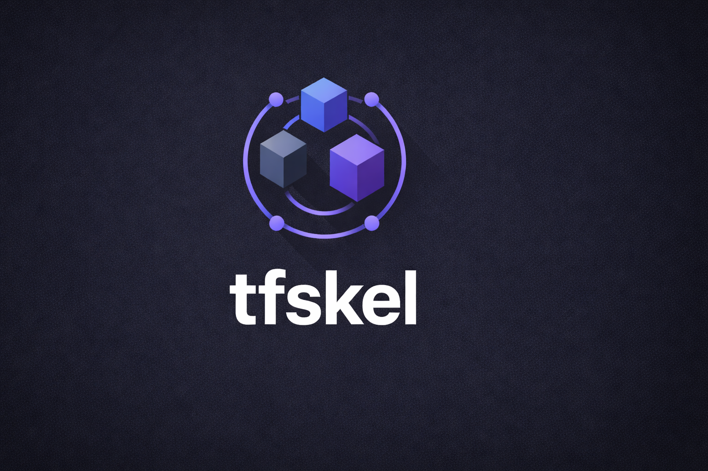
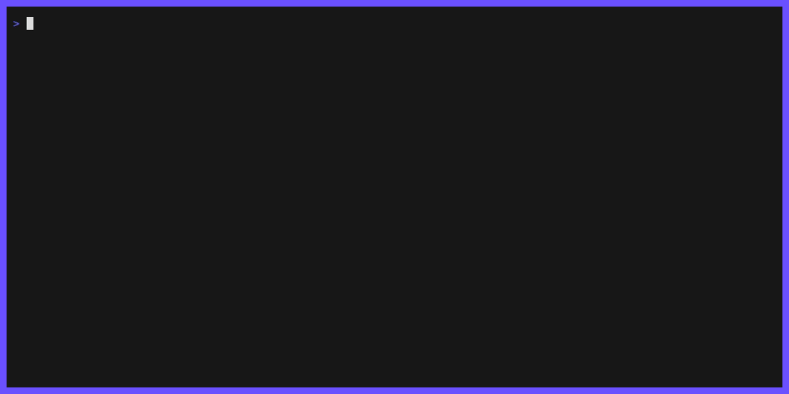
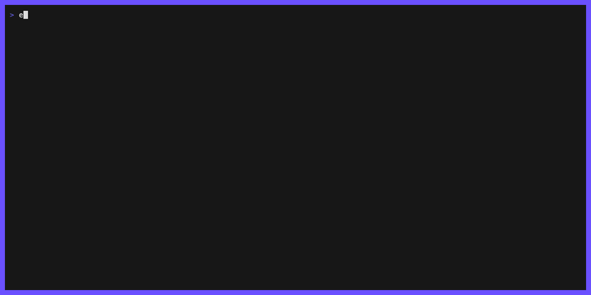

<div align="center">
<!--  -->

[![Test][test-img]][test]
[![GitHub Release][release-img]][release]
[![License: MIT][license-img]][license]
[![Stargazers][stars-shield]][stars-url]
[](https://codecov.io/gh/ishuar/tfskel)
[![Go Version][go-version-img]][go-version]

<div align="center">


<em>Simplified and predictable Terraform operations. Scale & Build infrastructure, not overhead!</em>
</div>

</div>

# tfskel

> [!WARNING]
> This project is in early development. APIs, commands, and configurations may introduce breaking changes between releases.

[`tfskel`](https://github.com/ishuar/tfskel) is a CLI tool that helps you run Terraform without the operational chaos.

It standardizes project structure, reduces drift, and makes plans easier to reason about, so you can spend less time managing Terraform and more time terraforming your infrastructure. No wrappers. No unnecessary abstraction. With `tfskel` Just well-structured, scalable Terraform that stays maintainable as you grow.

## Why tfskel

_Terraform itself isn’t hard. Managing it at scale is._

As infrastructure grows, so does the operational overhead — inconsistent folder structures, version drift, massive plan reviews, and environments slowly falling out of sync. Teams end up spending more time maintaining Terraform than actually building infrastructure.

[`tfskel`](https://github.com/ishuar/tfskel) removes that friction.

It gives you a clean, opinionated foundation that keeps your Terraform projects structured, consistent, and predictable from day one. Instead of reinventing layouts and fixing drift, you can focus on delivering Infrastructure as Code with confidence. _No copy-paste cycles. No structural chaos. No hidden abstraction layers._ Just well-organized, scalable Terraform — built to grow with your infrastructure.

> _tfskel is not a Terraform wrapper. It’s an operational discipline tool for Terraform._

### Features

1. Enforce consistent project structure across environments
2. Scaffold Terraform code using clean, maintainable templates
3. Upgrade generated files in-place when templates or config change (`--upgrade`)
4. Preview changes safely with `--dry-run` before writing anything
5. Detect AWS provider and Terraform version drift across the entire repo
6. Analyze Terraform plans to make reviews easier and safer with custom resources severity
7. Stay vanilla — no wrappers, no lock-in, just Terraform

> [!NOTE]
> *⭐️ If you find tfskel useful, consider starring the repo to stay updated and support the project. ⭐️*

## Installation

### Quick Install
- Install a specific version (recommended)
```bash
curl -fsSL https://raw.githubusercontent.com/ishuar/tfskel/main/install.sh | TFSKEL_VERSION=<RELEASED_VERSION> bash
```

- Install latest version
```bash
curl -fsSL https://raw.githubusercontent.com/ishuar/tfskel/main/install.sh | bash
```
- Custom install directory

```bash
curl -fsSL https://raw.githubusercontent.com/ishuar/tfskel/main/install.sh | INSTALL_DIR=~/.local/bin bash
```

### Install via Go

```bash
go install github.com/ishuar/tfskel@latest ## or released version
```

Make sure `$HOME/go/bin` is in your PATH.

> [!CAUTION]
> This project is developed with AI assistance. Please review the code carefully and perform your own due diligence. Thank you 🙏

## Quick Start

```bash
# 1. Create the repo layout, .tfskel.yaml, .mise.toml, lint config, and shared workflows
tfskel init --workflows

# 2. Fill in provider.aws.account_mapping and backend.s3.bucket_name in .tfskel.yaml

# 3. Create a root module for one app
tfskel scaffold myapp --env dev --region eu-central-1

# 4. Add the per-environment GitHub Actions plan/apply workflow
tfskel scaffold workflows --env dev

# 5. Check the repo is still in sync with .tfskel.yaml
tfskel validate

# 6. Review a plan before applying it
terraform plan -out plan.bin && terraform show -json plan.bin > plan.json
tfskel review plan --json-file plan.json
```

Add `--dry-run` to any command to see what it would write without touching disk.

## Commands

The full flag reference for every command is generated from the CLI itself and lives in [`docs/reference/`](docs/reference/tfskel.md). Run `tfskel <command> --help` for the same text in the terminal. For running tfskel in GitHub Actions, including the workflows it generates and the exit codes to gate on, see [docs/ci-usage.md](docs/ci-usage.md).

👉 For an end-to-end walkthrough, see [tfskel-demo PR #2](https://github.com/ishuar/tfskel-demo/pull/2): a new Terraform monorepo in four steps using the built-in GitHub Actions workflows.

| Command | What it does | Reference |
|---|---|---|
| `tfskel init` | Create the repo layout and config files | [init](docs/reference/tfskel_init.md) |
| `tfskel scaffold <app-dir>` | Create a root module from templates | [scaffold](docs/reference/tfskel_scaffold.md) |
| `tfskel scaffold workflows` | Create the per-environment plan/apply workflow | [scaffold workflows](docs/reference/tfskel_scaffold_workflows.md) |
| `tfskel validate` | Report version drift and missing tools, exit `2` on findings | [validate](docs/reference/tfskel_validate.md) |
| `tfskel review plan` | Summarize a plan JSON, flag risky changes, optional AI summary | [review plan](docs/reference/tfskel_review_plan.md) |
| `tfskel version` | Print version, commit, and build info | [version](docs/reference/tfskel_version.md) |

Every command accepts `--config`, `--verbose`, `--dry-run`, and `--no-color`. Exit code `1` always means an error, so gate CI on the specific finding codes above, not on `!= 0`.

### `tfskel init`

Creates the env/region layout, `.tfskel.yaml`, `.mise.toml`, lint and pre-commit config. Add `--workflows` for the shared reusable GitHub Actions workflows.

```bash
tfskel init --workflows
```



### `tfskel scaffold`

Creates a root module under `envs/<env>/<region>/<app-dir>` with `backend.tf` and `versions.tf` rendered from templates. `scaffold workflows` adds the per-environment plan/apply caller workflow.

```bash
tfskel scaffold myapp --env dev --region eu-central-1
tfskel scaffold workflows --env dev
```


### `tfskel validate`

Reports Terraform and provider version drift across the repo plus missing or outdated tools. Exits `2` when it finds something, so it works as a CI gate.

```bash
tfskel validate
```


### `tfskel review plan`

Summarizes a plan JSON file and flags critical changes. `--detailed-exitcode` exits `2` on changes and `3` on deletions or replacements; `--ai` adds a written summary (see below).

```bash
terraform plan -out plan.bin && terraform show -json plan.bin > plan.json
tfskel review plan --json-file plan.json --detailed-exitcode
```



### AI summary for plan reviews

`tfskel review plan --ai` asks an AI model to explain the plan in plain words below the table: what could break, security concerns, and how to roll back.

1. Pick a provider. Anthropic Claude is the default. For Google Gemini, set `TFSKEL_AI_PROVIDER=gemini`.
2. Set the API key in your environment: `ANTHROPIC_API_KEY` for Claude, `GEMINI_API_KEY` for Gemini. Keys are never read from the config file or flags.
3. Run `tfskel review plan --json-file plan.json --ai`.

Only changed attributes are sent, sensitive values are replaced with `<redacted>`, and output values are never sent. If the key is missing or the API call fails, tfskel warns and carries on with the same exit code, so CI never fails because of `--ai`. Works with `--format table` only. Model and token limit come from `--ai-model`, `--ai-max-tokens`, or `ai.model` and `ai.max_tokens` in `.tfskel.yaml`. See the [`review plan` reference](docs/reference/tfskel_review_plan.md) for all AI flags and defaults.

> **Note**: The AI summary does not replace scanners like `tfsec`, `checkov`, or `trivy`. Use both.

What is sent, how redaction works, and every failure mode are in [docs/ai-review.md](docs/ai-review.md).

## Configuration

Create a `.tfskel.yaml` in your project root. Precedence is **CLI flags → config file → defaults**.

- [docs/configuration.md](docs/configuration.md) documents every key, its default, and the validation behind each error. [`.tfskel.example.yaml`](.tfskel.example.yaml) is the annotated copy.
- `backend.s3.bucket_name`, `workflows.aws_role_arn`, and `workflows.aws_role_name` accept Go template syntax. The available placeholders, template functions, and custom template rules are in [docs/templates.md](docs/templates.md).

## Upgrading Generated Files

Every generated file carries a source marker recording the template and content hash that produced it. `--upgrade` on `init`, `scaffold`, and `scaffold workflows` re-renders only files whose marker no longer matches, and `--force` extends that to files without a marker. The decision rules, `templates.upgrade`, and `--upgrade-all` are in [docs/upgrading.md](docs/upgrading.md).

## Contributing

Contributions are what make the open source community such an amazing place to learn, inspire, and create. Any contributions you make are greatly appreciated.

If you have any suggestion that would make this project better, feel free to fork the repo and create a pull request. You can also simply open an issue with the tag "enhancement" with your suggestion.

> [!Tip]
> See [CONTRIBUTING.md](CONTRIBUTING.md) for guidelines.

1) Fork the repository on GitHub
2) Clone your fork and create a new branch
3) Make your changes
4) Run tests and checks
5) Push your branch and open a pull request

```bash
git clone https://github.com/<your-username>/tfskel.git
cd tfskel
git checkout -b my-feature-branch
make test   # Run tests
make check  # Run all quality checks
```

> [!Important]
> Please keep your pull requests small and focused. This will make it easier to review and merge.

## License
Released under [MIT LICENSE](/LICENSE)

<p align="right"><a href="#top">Back To Top ⬆️</a></p>

<!-- MARKDOWN LINKS & IMAGES -->
<!-- https://www.markdownguide.org/basic-syntax/#reference-style-links -->

[go-version-img]: https://img.shields.io/badge/Go-1.24%2B-blue.svg
[go-version]: https://golang.org
[test]: https://github.com/ishuar/tfskel/actions/workflows/test.yaml
[test-img]: https://github.com/ishuar/tfskel/actions/workflows/test.yaml/badge.svg
[release]: https://github.com/ishuar/tfskel/releases
[release-img]: https://img.shields.io/github/release/ishuar/tfskel.svg?logo=github
[license]: https://github.com/ishuar/tfskel/blob/main/LICENSE
[license-img]: https://img.shields.io/github/license/ishuar/tfskel?color=blue
[stars-url]: https://github.com/ishuar/tfskel/stargazers
[stars-shield]: https://img.shields.io/github/stars/ishuar/tfskel?style=flat&logo=github
