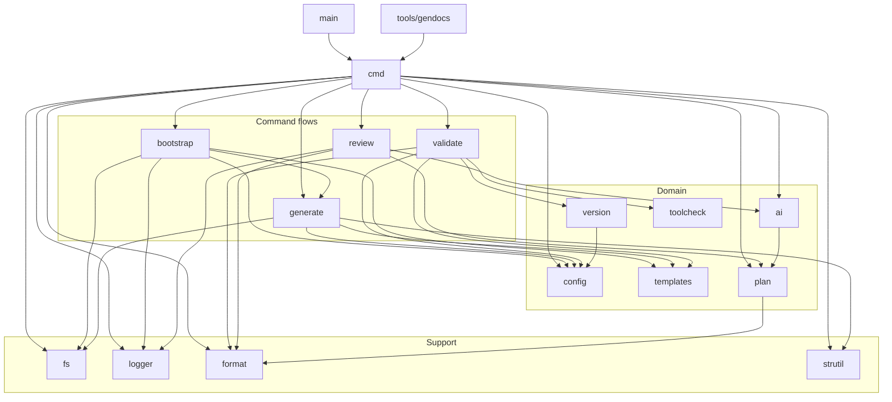

# Architecture

tfskel is one Go binary: a thin cobra CLI in `cmd/` over a set of focused packages in `internal/`. Every package carries a package comment (`doc.go`) that states what it owns, what it must not know about, and which seams exist for tests. Those comments are the authoritative description of each component and change in the same diff as the code; `golangci-lint` fails on a package without one. This page is the map that connects them.

Read a package's description with `go doc`:

```bash
go doc ./internal/generate
```

## Package map

Arrows point from importer to imported. The edge list is derived from the real import list, not drawn by hand: run the command under the diagram and paste its output over the edge lines inside the `subgraph` blocks when packages change.



```bash
# One "importer --> imported" line per in-module edge, ready to paste into the mermaid block.
go list -f '{{$p := .ImportPath}}{{range .Imports}}{{$p}} {{.}}{{"\n"}}{{end}}' ./... \
  | grep ' github.com/ishuar/tfskel' \
  | sed -e 's#github.com/ishuar/tfskel/##g' -e 's#^github.com/ishuar/tfskel #main #' \
        -e 's#internal/##g' -e 's#tools/gendocs#gendocs#' -e 's# # --> #' \
  | sort
```

## Packages

| Package | Owns | User docs |
| --- | --- | --- |
| `main` | Entry point: runs the cobra tree and maps `cmd.ExitError` to the process exit code. | |
| `cmd` | Cobra command tree, flag parsing, boundary validation, flag > config > default resolution, exit-code contract. `Long`/`Example` strings are rendered into `docs/reference/` by `tools/gendocs`. | [reference](reference/tfskel.md) |
| `internal/bootstrap` | `tfskel init`: one-time project setup from zero (root config files, `envs/<env>/<region>/`, optional shared workflows, seed `.tfskel.yaml`). | [upgrading](upgrading.md) |
| `internal/generate` | `tfskel scaffold` and `scaffold workflows`: per-app rendering, output paths, source and metadata markers, `--upgrade` decisions, operation summary. | [templates](templates.md), [upgrading](upgrading.md) |
| `internal/validate` | `tfskel validate`: the config and tools checks, findings, report, exit code. | [ci-usage](ci-usage.md) |
| `internal/review` | `tfskel review plan`: parse, analyze, filter, format, optional AI step, exit-code derivation. The AI step is additive and can never change the exit code. | [ai-review](ai-review.md) |
| `internal/config` | Loading, defaults, deprecation warnings, flag overrides and validation of `.tfskel.yaml`. | [configuration](configuration.md) |
| `internal/templates` | Embedded and custom Go templates, the `Data` struct, the function map, per-template hashes. Renders strings only. | [templates](templates.md) |
| `internal/plan` | Terraform plan JSON parsing, change and severity analysis, filtering, table/JSON/CSV output, detailed exit code. | [reference](reference/tfskel_review_plan.md) |
| `internal/ai` | Provider-agnostic `Client` interface, Anthropic and Gemini implementations, the sanitized payload, the system prompt. | [ai-review](ai-review.md) |
| `internal/version` | HCL scanning for Terraform and provider constraints, drift analysis against config. | [ci-usage](ci-usage.md) |
| `internal/toolcheck` | Detection of required tools on `PATH` and their mise status. | [ci-usage](ci-usage.md) |
| `internal/fs` | `FileSystem` interface with OS, in-memory and dry-run implementations. All writes go through it. | |
| `internal/logger` | Console logger; log lines versus report output; `SetMachineOutput` for json/csv modes. | |
| `internal/format` | Output format names, shared styles, terminal width constants, the single color decision. | |
| `internal/strutil` | Region abbreviation, name normalization, input trimming. No domain types. | |
| `tools/gendocs` | Renders the cobra tree to `docs/reference/`. Not shipped in the binary. | |

## Command flows

Each flow lists the packages a command touches, in order.

- **init**: `cmd` resolves `--dir` and flags, `bootstrap` reads an existing `.tfskel.yaml` or uses defaults, renders root files through `templates`, writes through `fs`, and reuses `generate`'s marker and upgrade helpers.
- **scaffold**: `cmd` loads and validates `config`, builds a `generate.Generator` with an `fs.FileSystem` (dry-run wrapped when `--dry-run`), which builds template `Data`, renders through `templates`, injects markers, and writes. `scaffold workflows` is the same flow against the `github/` templates.
- **validate**: `cmd` loads and validates `config`, `validate.Runner` runs the selected checks via `version` (HCL drift) and `toolcheck` (mise), and the report's exit code becomes the process exit code.
- **review plan**: `cmd` validates flags and the plan file, resolves plan and AI settings from viper, then `review.Run` parses and analyzes through `plan`, filters, formats, and streams the optional narrative through `ai`. The exit code comes from the analysis alone; `--detailed-exitcode` decides whether the CLI acts on it.

## Boundaries that hold everywhere

1. **Validation at the edge.** Flags, user input, file existence and external responses are checked in `cmd` or at the I/O call. Internal functions trust their arguments; there are no defensive re-checks between packages.
2. **Writes through `fs.FileSystem`.** Every file tfskel creates passes through the interface, which is how `--dry-run` and the in-memory tests work without special cases in the generators.
3. **Log lines are not output.** Reports go to stdout directly; the logger carries progress and warnings, and moves to stderr in json/csv modes so stdout stays parseable.
4. **Exit 1 means error, always.** Non-error, non-zero codes (validate 2; review plan 2 and 3) are returned as `cmd.ExitError` and never overlap with the error code.
5. **One source of truth for derived data.** Severity drives both the table and the AI payload from the same `plan.PlanAnalysis`; `docs/reference/` is generated from the cobra tree; the critical-resource list is merged once in `cmd` and passed down.

## Related

- [CONTRIBUTING.md](../CONTRIBUTING.md): build, test, lint and commit conventions.
- [release-system.md](release-system.md): how releases are cut.
